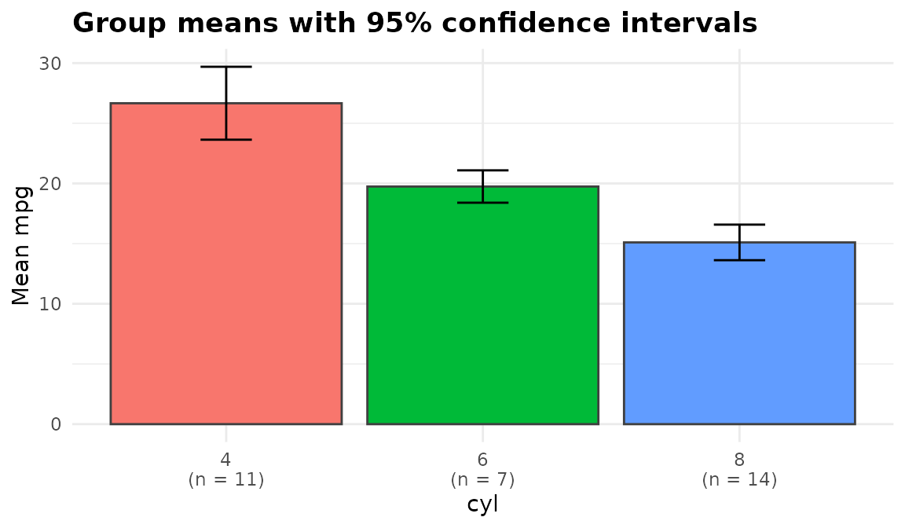
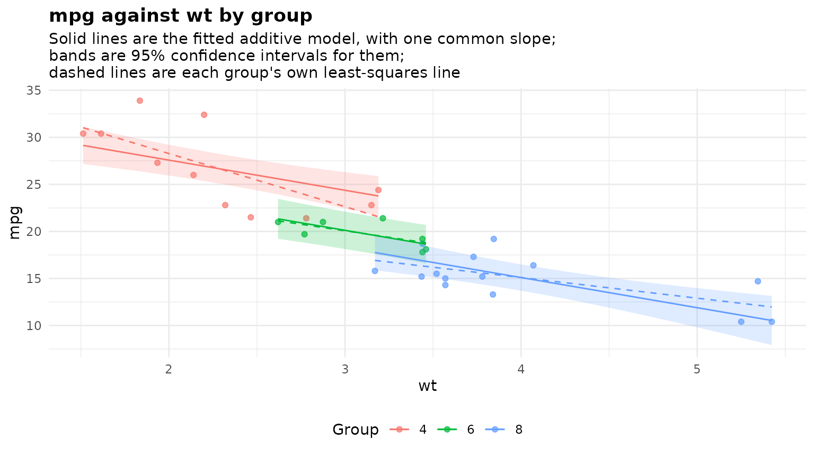

# Get started with anovakit

This page runs one analysis from start to finish, repeats it with a
model that adjusts for a covariate, and lists the arguments every
function shares. The other six functions return the same kind of object,
with the same `$notes`, `$emmeans`, `$posthoc` and
[`plot()`](https://rdrr.io/r/graphics/plot.default.html).

## Installation

``` r

# install.packages("remotes")
remotes::install_github("elkronos/anovakit", build_vignettes = TRUE)
```

``` r

library(anovakit)
```

## A first analysis

`mtcars` records the fuel economy (`mpg`) of 32 cars with 4, 6 or 8
cylinders. The question is whether mean fuel economy differs by cylinder
count.

``` r

table(mtcars$cyl)
#> 
#>  4  6  8 
#> 11  7 14
round(tapply(mtcars$mpg, mtcars$cyl, sd), 2)
#>    4    6    8 
#> 4.51 1.45 2.56
```

The 4-cylinder cars vary far more than the 6-cylinder ones, so the
comparison should not assume equal variances.
[`anova_welch()`](https://elkronos.github.io/anovakit/reference/anova_welch.md)
does not.

``` r

fit <- anova_welch(mtcars, "mpg", "cyl")
fit
#> Welch's analysis of variance 
#> ----------------------------
#> Call: anova_welch(data = mtcars, response = "mpg", groups = "cyl")
#> Observations used: 32
#> 
#> Omnibus test (Welch F)
#>   term statistic num_df den_df   p_value
#> 1  cyl     31.62      2  18.03 1.271e-06
#> 
#> Notes
#>   - Largest group variance is 9.63 times the smallest. Welch's test handles this; the classical F test would not.
#> 
#> Plots available: means, box, qq
#>   (use plot(x, which = "means"))
```

`cyl` is numeric in `mtcars`; grouping columns are converted to factors.

The printed result has four parts: the call and the number of rows used,
the omnibus test, the notes, and the names of the plots that were built.

### The notes

`$notes` records what the function decided on your behalf, what it could
not compute, and anything that changes how a number should be read.

``` r

fit$notes
#> [1] "Largest group variance is 9.63 times the smallest. Welch's test handles this; the classical F test would not."
```

Here it reports the variance ratio, which is the reason to use Welch’s
test. On other data it would say how many rows were dropped for missing
values, or that a check could not run. Read it before you report
anything from a fit.

### The summary

[`summary()`](https://rdrr.io/r/base/summary.html) adds the assumption
checks, effect sizes, group summaries and pairwise comparisons.

``` r

summary(fit)
#> Welch's analysis of variance 
#> ----------------------------
#> Call: anova_welch(data = mtcars, response = "mpg", groups = "cyl")
#> Observations used: 32
#> 
#> Omnibus test (Welch F)
#>   term statistic num_df den_df   p_value
#> 1  cyl     31.62      2  18.03 1.271e-06
#> 
#> Notes
#>   - Largest group variance is 9.63 times the smallest. Welch's test handles this; the classical F test would not.
#> 
#> Plots available: means, box, qq
#>   (use plot(x, which = "means"))
#> 
#> Assumption checks
#> 
#>   normality
#>  group  n statistic p_value note
#>      4 11    0.9124  0.2606 <NA>
#>      6  7     0.899  0.3252 <NA>
#>      8 14    0.9318  0.3229 <NA>
#> 
#>   variance_ratio
#>     9.626
#> 
#> Effect sizes
#>  group1 group2 hedges_g conf_low conf_high magnitude            standardiser
#>       4      6    1.933   0.8801     3.208     large sqrt((s1^2 + s2^2) / 2)
#>       4      8    3.005    1.752     4.518     large sqrt((s1^2 + s2^2) / 2)
#>       6      8    2.139    1.121     3.305     large sqrt((s1^2 + s2^2) / 2)
#> 
#> Group summaries (95% intervals)
#>  group  n  mean    sd     se conf_low conf_high
#>      4 11 26.66  4.51   1.36    23.63     29.69
#>      6  7 19.74 1.454 0.5494     18.4     21.09
#>      8 14  15.1  2.56 0.6842    13.62     16.58
#> 
#> Pairwise comparisons
#>  group1 group2 difference conf_low conf_high statistic    df   p_value
#>       4      6      6.921    3.751     10.09     4.719 12.96 0.0004048
#>       4      8      11.56    8.319     14.81     7.597 14.97 1.641e-06
#>       6      8      4.643    2.803     6.483     5.291  18.5  4.54e-05
#>  p_adjusted adjustment
#>   0.0004048       holm
#>   4.924e-06       holm
#>   9.081e-05       holm
```

The assumption checks are the ones that fit the method. Welch’s test
allows unequal variances, so normality is tested within each group, not
on pooled residuals. The effect sizes are Hedges’ g on the average of
the two group variances (the `standardiser` column gives the formula),
with intervals. The pairwise comparisons are Welch t tests; `p_value` is
unadjusted and `p_adjusted` uses Holm’s method, the default for
[`anova_welch()`](https://elkronos.github.io/anovakit/reference/anova_welch.md).

Every table is a data frame you can use directly:

``` r

fit$posthoc[, c("group1", "group2", "difference", "conf_low", "conf_high",
                "p_adjusted")]
#>   group1 group2 difference conf_low conf_high   p_adjusted
#> 1      4      6   6.920779 3.751376 10.090182 4.048495e-04
#> 2      4      8  11.563636 8.318518 14.808755 4.924043e-06
#> 3      6      8   4.642857 2.802925  6.482789 9.080709e-05
```

### A plot

Plots are built when you fit and returned as `ggplot2` objects. Nothing
is drawn until you print one.

``` r

plot(fit, "means")
```



## The same analysis with a covariate

Heavier cars use more fuel, and the 8-cylinder cars are the heaviest. An
ANCOVA compares the cylinder groups at the same weight (`wt`, in
thousands of pounds).

``` r

anc <- anova_ancova(mtcars, "mpg", "cyl", "wt")
anc
#> Analysis of covariance (Type III) 
#> ---------------------------------
#> Call: anova_ancova(data = mtcars, response = "mpg", groups = "cyl", covariates = "wt")
#> Observations used: 32
#> 
#> Omnibus test (Type III, F)
#>        term sum_sq df statistic  p_value
#> 1        wt  118.2  1     18.08 0.000213
#> 2       cyl  95.26  2     7.286 0.002835
#> 3 Residuals  183.1 28        NA       NA
#> 
#> Notes
#>   - Covariate(s) mean-centred before fitting (wt: 3.217), so the intercept refers to the covariate mean rather than to covariate = 0. $emmeans are evaluated at the covariate mean either way.
#>   - Slopes are consistent with being equal across groups (p = 0.1239), so the additive model was used. A non-significant test is not proof of equal slopes, only an absence of evidence against it, and the p-values below do not allow for the model having been chosen by a test on these same data: if the slopes do differ, the group row and $posthoc can reject more often than their nominal level, somewhat so even when the groups were randomised and far more so when the groups' covariate means are unequal. Setting force_interaction = TRUE in advance avoids the selection step.
#>   - The covariate means differ between groups (largest difference: wt 2.72 pooled within-group SDs). With the slopes assumed equal, any real difference in slopes biases the adjusted comparisons by the slope difference times the covariate-mean difference, and the homogeneity-of-slopes test often lacks the power to detect a difference large enough to matter, so the group row and $posthoc can reject far more often than their nominal level. force_interaction = TRUE does not assume equal slopes.
#>   - $emmeans are evaluated at the covariate mean, but wt = 3.217 lies outside the range observed in 4 [1.513, 3.19]. The adjusted means there are extrapolations along the fitted slope to covariate values none of those observations have, so they and the comparisons that involve them rest on the model's linearity rather than on data.
#> 
#> Plots available: residuals, qq, covariate, emmeans
#>   (use plot(x, which = "residuals"))
```

The call has the same shape, with the covariate as the fourth argument.
The notes record four things:

- `wt` was mean-centred at 3.217. The model is additive, so centring
  changes only the intercept, and `$emmeans` are evaluated at that mean
  weight either way. Centring matters when the model includes the
  group-by-covariate term.
- The homogeneity-of-slopes test gave p = 0.124, so the function fitted
  the additive model, and the p-values do not allow for that choice.
- The groups’ mean weights differ by up to 2.72 pooled within-group
  standard deviations, which makes the adjusted comparisons sensitive to
  a slope difference the test may have missed.
- The heaviest 4-cylinder car weighs 3.190, less than the average car,
  so the marginal mean for that group is an extrapolation.

These are observational data, and the notes say how far the adjusted
comparison leans on the model. The marginal means and comparisons are in
the same places as before:

``` r

anc$emmeans
#>   cyl estimate        se df conf_low conf_high
#> 1   4 23.67753 1.0428474 28 21.54136  25.81371
#> 2   6 19.42195 0.9693650 28 17.43630  21.40761
#> 3   8 17.60668 0.9025074 28 15.75797  19.45538
anc$posthoc[, c("contrast", "estimate", "conf_low", "conf_high",
                "p_adjusted")]
#>      contrast estimate   conf_low conf_high  p_adjusted
#> 1 cyl4 - cyl6 4.255582  0.8259527  7.685212 0.012696957
#> 2 cyl4 - cyl8 6.070860  1.9825209 10.159199 0.002785371
#> 3 cyl6 - cyl8 1.815277 -1.5439851  5.174540 0.387082329
```

The covariate plot draws the fitted model (solid lines, one common
slope) and each group’s own least-squares line (dashed) over the data.
The 4-cylinder cars (at most 3.190) and the 8-cylinder cars (at least
3.170) barely overlap in weight.

``` r

plot(anc, "covariate")
```



To fix the model in advance instead of letting the slopes test choose
it, set `force_interaction = TRUE`. The [ANCOVA
walkthrough](https://elkronos.github.io/anovakit/articles/articles/ancova.md)
covers that choice, the slopes test and covariate centring.

## Arguments every function shares

Each function takes the data first and names columns as character
strings.
[`anova_manova()`](https://elkronos.github.io/anovakit/reference/anova_manova.md)
takes `responses` (plural), and
[`anova_rm()`](https://elkronos.github.io/anovakit/reference/anova_rm.md)
takes `response` with `subject`, `within` and `between`. These arguments
mean the same thing wherever they appear:

| Argument | Accepted by | Default | What it does |
|----|----|----|----|
| `conf_level` | all eight | `0.95` | The level of every interval in the returned tables. |
| `adjust` | all eight | `"holm"` (welch), `"BH"` (kw), `"tukey"` (the rest) | The multiplicity adjustment for the pairwise comparisons. |
| `posthoc` | all eight | `TRUE` | `FALSE` skips the pairwise comparisons, with a note (in [`anova_welch()`](https://elkronos.github.io/anovakit/reference/anova_welch.md) this also empties `$effect_sizes`). The six model-based functions also skip them, with a note, above 5000 comparisons. |
| `plots` | all eight | `TRUE` | `FALSE` skips building the figures, which is faster. |
| `verbose` | all eight | `FALSE` | Progress messages through [`message()`](https://rdrr.io/r/base/message.html). |
| `interaction` | ancova, manova, bin, count, glm | `FALSE` (`TRUE` in ancova) | Additive, full factorial, or interactions up to a given order. |
| `type` | ancova, rm (through `...`), manova, bin, count, glm | `"II"` (`"III"` in ancova and rm) | Type II or Type III tests; `"III"` fits the model under sum-to-zero contrasts. |
| `covariates` | ancova, manova | none in manova (required in ancova) | Numeric columns to adjust for. |
| `vcov_type` | ancova, bin, count, glm | `"model"` | `"HC0"` to `"HC4"` gives sandwich standard errors. |
| `weights` | bin, count, glm | `NULL` | Prior weights, named as a column. |

[`anova_welch()`](https://elkronos.github.io/anovakit/reference/anova_welch.md)
and
[`anova_kw()`](https://elkronos.github.io/anovakit/reference/anova_kw.md)
accept the [`p.adjust()`](https://rdrr.io/r/stats/p.adjust.html) methods
for `adjust`. The other six compare through emmeans and also accept
`"tukey"`, `"sidak"`, `"scheffe"` and `"dunnettx"`. Arguments specific
to one function are on its help page and in its walkthrough.

## Where to go next

- [Choose an
  analysis](https://elkronos.github.io/anovakit/articles/articles/choosing.md):
  which of the eight functions fits your data.
- A walkthrough for each function:
  [Welch](https://elkronos.github.io/anovakit/articles/articles/welch.md),
  [Kruskal-Wallis](https://elkronos.github.io/anovakit/articles/articles/kruskal-wallis.md),
  [ANCOVA](https://elkronos.github.io/anovakit/articles/articles/ancova.md),
  [repeated
  measures](https://elkronos.github.io/anovakit/articles/articles/repeated-measures.md),
  [MANOVA](https://elkronos.github.io/anovakit/articles/articles/manova.md),
  [binary
  outcomes](https://elkronos.github.io/anovakit/articles/articles/binary.md),
  [counts and
  rates](https://elkronos.github.io/anovakit/articles/articles/counts.md)
  and [other GLM
  families](https://elkronos.github.io/anovakit/articles/articles/glm.md).
- [Working with
  results](https://elkronos.github.io/anovakit/articles/articles/results.md):
  every component of the returned object, the `emmeans` grid, tables for
  a report, many analyses at once.
- [Diagnostics](https://elkronos.github.io/anovakit/articles/articles/diagnostics.md):
  what each assumption check computes and how to read it.
- [Plots and
  themes](https://elkronos.github.io/anovakit/articles/articles/visuals.md):
  customising the figures.
- [Weights and robust standard
  errors](https://elkronos.github.io/anovakit/articles/articles/weights.md):
  frequency, trial and sampling weights, and `vcov_type`.
- [Design
  choices](https://elkronos.github.io/anovakit/articles/articles/design.md):
  why the defaults are what they are.

[`?anovakit_fit`](https://elkronos.github.io/anovakit/reference/anovakit_fit.md)
documents every component of the returned object, and each function’s
help page documents its own arguments.
